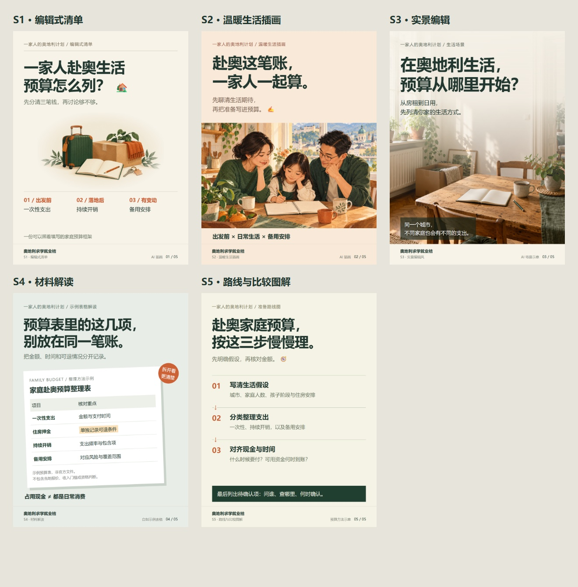

# 奥地利求学就业桔 · 自媒体内容创作 Skill

为“奥地利求学就业桔”持续创作奥地利生活文化、护理学习与职业准备、家庭教育和生活规划内容。以中文知识表达建立信任，支持小红书完整图文、无露脸视频脚本、自然评论设计及发布前审核。

**把奥地利的生活讲得有画面，把学习、工作和家庭准备讲具体。**

品牌定位：**奥地利学习、就业与家庭生活规划咨询**。

`Skill ID: austria-study-career-content` · `版本：1.0.0` · `更新：2026-11-02` · `主要语言：简体中文`

[快速开始](#start) · [内容方向](#content) · [参考来源库](#sources) · [五种风格](#styles) · [本地出图](#renderer) · [交付与验证](#validation) · [文件导航](#files)

## V10：把视觉完成度落实到整套图文


正式制作改用图片与信息共同编排的设计方法，新增三套完整样稿（每套四页），配实际 AI 图片、正文、话题、预览与可编辑源。封面、图片解释、对照、工作表和步骤页有不同任务。旧基础文字示例降为技术回归，不再作为品牌正式图文的默认视觉起点。

这些图片是 AI 场景/插画，不是实拍或客户案例；正文事实另有出处。查看 [正式设计资源](assets/editorial/README.md) 与 [视觉制作规范](references/visual-production.md)。

## 适合怎样的内容团队？

适合希望稳定输出有用、有趣内容，但自有实拍、采访和客户案例素材有限的团队。主要生产方式是公开资料研究、独立解释、原生排版和明确标识的 AI 插画，不要求假装亲历，也不依赖成功案例获客。

生活文化可以独立成篇，让读者欣赏、好奇、交流。职业与家庭内容帮助相关读者认出自己的问题，再在主动咨询后如实沟通实际服务。没有固定周更数量、强制内容比例或每篇必带的咨询广告。

## 能完成什么？

| 任务 | 默认交付 | 实际边界 |
|---|---|---|
| 小红书完整图文 | 封面与全部内页独立图片、标题、正文、话题、预览、可编辑源文件 | 需要可用的排版/出图工具；只给文案不算完整图片包 |
| 生活文化与工作体验 | 场景叙事、文化解释、主题组图与自然问题 | 不伪装实拍、亲历、客户故事或全民待遇 |
| 护理与家庭准备 | 按背景和阶段组织资料、问题、任务与解释 | 不凭通用信息判断个人资格或保证结果 |
| 国内外内容研究 | 来源链接、实际可见范围、借鉴方法与独立选题 | 灵感、事实和图片/视频使用许可分别核对 |
| 系列与搜索表达 | 明确每篇增量、查询意图、术语与相关话题 | 不编搜索量，不保证 SEO/GEO、流量或 AI 引用 |
| 无露脸视频/数字人脚本 | 时间、旁白、画面、字幕、素材和来源 | 成片与可编辑时间线需另有实际工具 |
| 局部修改与反馈分析 | 保留指定内容、独立版本、证据和改动假设 | 不自动发布、回复、私信或收集客户资料 |

<a id="start"></a>
## 快速开始

1. 下载完整仓库，保留 `SKILL.md`、`references/`、`assets/` 等相对目录。
2. 按所用客户端的说明加载整个 Skill 文件夹；不能只凭 ID 假定已安装。
3. 告诉 Agent 主题、读者和形式。有明确范围时按要求交付；只给主题且未指定形式时默认小红书完整图文。

```text
用 $austria-study-career-content
围绕“认识奥地利咖啡馆文化”制作一篇小红书完整图文。
参考来源库中实际可读的资料，独立写作，不假装实拍或亲历。
保持有画面感、低销售感，可加入明确标识的 AI 插画与少量 emoji。
交付独立图片、标题正文、话题、预览与可编辑源文件。
```

没有 Skill 导入入口时，让可读本地文件的 Agent 先读 [SKILL.md](SKILL.md)，再按任务读取相关资料。普通聊天界面需实际提供这些文件。

<a id="content"></a>
## 长期内容方向

### 奥地利美好生活与文化

城市和季节氛围、咖啡馆与艺术、亲子日常、工作之外的生活，以及有依据的好条件。内容可以图多字少，也可以深入解释一个文化细节，不强制变成申请清单或咨询入口。

新增 [生活文化内容卡](references/knowledge-lifestyle-culture.md)，提供已读来源与编辑切口；不把旅游宣传当作居民待遇。正向情绪可以充分呈现，影响理解的条件仍需准确。

### 护理学习与职业准备

区分相关专业在读、已毕业待衔接及已有资格的读者，围绕语言、课程与实践记录、资格概念、岗位阅读和职业生活展开。护理教育、资格认定、职业注册、雇主录用及相关许可分别核对。

不依赖自有护士案例，也不编患者、雇主、工资单或合作。其他职业须另有对应知识和业务范围，不能直接复制护理条件。

### 家庭教育与生活规划

围绕家庭共同目标、孩子学习、预算、现金流、日常活动与生活适应，提供可讨论、可查证的小任务。家庭目标与具体资格分开，不用收入标签直接判断。

三个方向共同组成账号；单篇只需完成一个主要目标，允许止于欣赏、认识或交流。

<a id="sources"></a>
## 国内外内容参考来源库

新增 [source-library.md](references/source-library.md)，仅保留 **21 项有实际可读内容的来源**：19 项实质正文、2 项局部内容。2026-11-02 复核；不可读的社交入口已替换为同机构可读文章或专题，不用空链接凑数量。

| 来源范围 | 代表内容 | 可以怎样使用 |
|---|---|---|
| 中文内容 | 维也纳旅游局微博片段、中文博物馆区专题、使馆文化处具体文化文章 | 从实际文字中找生活和文化问题；片段不当全文 |
| 海外内容 | Vienna BAHÖ 文字页、Easy German 第 402 期介绍 | 借鉴对话组织和生活化问题；未看视频不分析镜头 |
| 专业与主题正文 | 文化条目、城市专题、职业信息、护理日常、季节及家庭主题 | 回到原始正文核对背景，再独立解释 |

只有导航、登录页、空壳频道或搜索摘要的，不进入活跃来源数量。原平台不可读时，核对同机构的官网、另一官方平台或具体文章；仍无可用内容就移出主库。片段和节目介绍明确标为部分可读，不等于全文或最新数据。

新增专业来源分区：配额相关居留的许可说明与使领馆年度通知、紧缺职业申请与职业清单、护理认定与学校规则，以及 ORF 和护理协会的相关报道。每项标明用途和不能推导的结论；第三方报道不写成本品牌案例。内部来源保留准确名称，公开内容继续按知识型、低销售感边界制作。

**参考内容 → 提炼读者问题与表达机制 → 核验事实 → 独立组织 → 制作与审核。**

不逐句改写、整篇翻译或搬运视频；公开可读不等于素材可使用。不会把别人的经历写成我们的案例。来源失效、异常或内容偏离时暂停使用，不沿用旧信誉。

本库是可维护的参考起点，不自动后台采集、不保证持续更新。普通创作将新来源暂存在用户项目中；用户要求维护 Skill 时再补入公共库。完整方法见 [编辑生产方法](references/editorial-production.md)。

## 内容生产的方法

- **系列有增量：** 每篇独立回答一个问题，后续增加新解释，不靠扣留答案追更，不只换标题重复清单。
- **搜索表达自然：** 根据查询意图写标题和正文，术语称谓一致、答案与条件清楚，出处可追溯；不堆关键词、不编热度。
- **评论带来新问题：** 区分原稿没讲清、兴趣延伸、准备需求、个案和不同观点，再决定补充、续篇或回复草稿。
- **实用内容可执行：** 德语小任务、岗位说明阅读、资料解释、家庭讨论和预算变量，不只反复说“先核对”。
- **资料短缺有替代：** 用知识解释、图解和有标识的 AI 情境，避免假采访、假现场和假案例。

<a id="styles"></a>
## 五种小红书视觉方向与完整基础示例

以下保留原有五张封面 DEMO：



V10 的正式设计起点是 [三套有实际配图的完整样稿](assets/editorial/README.md)。以下五类基础输入保留作回归与极简测试，不再自动当作正式成品。

| 风格 | 完整示例 | 主要表达 |
|---|---|---|
| S1 编辑式清单 | [德语练习任务](assets/examples/s1.json) | 清晰分组、任务与回看 |
| S2 温暖生活插画方向 | [家庭讨论](assets/examples/s2.json) | 暖色卡片、偏好与家庭问题 |
| S3 实景编辑方向 | [咖啡馆文化](assets/examples/s3.json) | 编辑式层级、文化细节与偏好 |
| S4 材料解读 | [通知阅读方法](assets/examples/s4.json) | 表格、范围与原文/推断区分 |
| S5 路线与比较图解 | [护理任务整理](assets/examples/s5.json) | 步骤、节点与任务关系 |

S2/S3 的完整基础示例采用无配图版本；需要插画或实景效果时，另加入实际 AI 成图或授权素材。基础编排与原封面艺术设计是不同验证对象，不能称为五套复杂艺术模板已全部完成。

editorial 模式支持图片主导封面、图片解释、对照卡片、工作表和任务步骤，按内容选择组合。页数由内容决定；四页仅是示例长度。插画和 emoji 服务于表达，不能挤占正文与条件；内容单薄时合并或补充，不靠装饰撑页。

<a id="renderer"></a>
## 本地图文导出

需要 **Node.js 20+、Playwright、可用的 Chromium 系浏览器与中文字体**。仓库不附浏览器、字体或 `node_modules`。

在仓库根目录运行：

```sh
npm install
node scripts/render-post.cjs --input assets/editorial/family.json --out output/family-editorial-v01
```

安装会联网获取依赖。已有依赖可用 `PLAYWRIGHT_MODULE_PATH` 指向模块目录，`BROWSER_EXECUTABLE` 或 `--browser` 指向实际存在的 Chrome/Edge；配置保存在本机，不写进公共代码。默认浏览器不存在时，指定已有浏览器或按 Playwright 文档准备。

输出包含独立图片 `images/`、发布文案 `publish.md`、整套预览 `preview.jpg`、图片摘要 `manifest.json` 与可编辑 `source/`。输入未提供 publish 字段时只导出图片制作包。

支持 UTF-8 BOM、未知字段报错、溢出拒绝，以及指定页更新。图片的 `imageFit`、`imageHeight`、`imageFocus` 可控制完整呈现、裁切和焦点；图片说明和适配字段必须有对应图片。

```sh
node scripts/render-post.cjs --input assets/editorial/family.json --out output/family-editorial-v02 --base output/family-editorial-v01 --pages assumptions
```

先修改指定页 JSON，再执行局部更新。未选页保持原始图片并核对摘要；改页序、全局设置或升级渲染器需完整导出新版本。输出目录必须不存在。字段和运行细节见 [制作工具指南](references/production-tools.md)。

<a id="validation"></a>
## 交付与验证

交付状态按实际完成程度说明：文案/策划稿、待核验稿、已导出待目视检查、本地发布包检查完成。只要文案时，完成文案就是本次范围，不自动扩大为图片或视频制作。

内部流程收拢为：明确任务 → 确认工具/素材 → 查来源与主张 → 初审事实与公开口径 → 成稿与逐页任务 → 整套设计及素材 → 制作 → 内容/视觉分别验收 → 交付记录。明确任务直接执行，不为每一步增加人工审批。

自动检查涉及输入、解码、溢出、图片保存、源文件迁移和局部更新。五种基础回归输入与三套 editorial 图文均纳入浏览器导出测试。运行方式：

```sh
npm test
```

默认执行输入测试；设置 `RUN_RENDER_TESTS=1` 启用浏览器测试，可配合上述模块与浏览器环境变量。测试通过不代表政策事实、画面语义、中文/emoji 缺字或平台效果已经自动验证。

图片导出后仍需逐页、手机尺寸检查。视频需实际制作、导出与播放验证。仓库另附 [三类无露脸短脚本范例](references/video-production.md)：生活氛围、知识解释、资料解读；它们是脚本与制作规范，未冒充完成的成片模板。

## 专业知识、公开表达与服务

- [护理职业知识库](references/knowledge-nursing-career.md)：8 组卡片，涵盖起点、职业层级、认定、语言、注册、岗位与准备。
- [家庭生活知识库](references/knowledge-family-residence.md)：8 组卡片，区分目标、条件、材料、年度节点和后续安排。
- [公开表达规范](references/public-expression-rules.md)：知识与生活视角、低销售感，不强推办理路径或结果。
- [证据与审核](references/evidence-review.md)：来源、日期、对象与条件分别核对，知识卡不是实时数据库。

内部知识保留准确名称，公开解释不因避词而改变条件。账号定位为咨询，不隐瞒实际商业服务；正式沟通如实说明范围、责任和费用。不承诺包过、包就业或跨国权利，不将生活美好写成人人可得的待遇。

客户资料、内部报价、合作证明和未公开案例留在私有工作区。可选本机配置 `service-context.local.json` 指向用户指定的简报，不进入公开包。创作本身不授权自动发布、私信或联系客户。

<a id="files"></a>
## 文件导航

| 文件 | 用途 |
|---|---|
| [SKILL.md](SKILL.md) | 入口、任务范围与固定标准 |
| [品牌标准](references/brand-standard.md) / [文案标准](references/brand-copy.md) | 定位、受众与自然表达 |
| [受众与选题](references/audience-and-topics.md) | 背景、阶段与去重 |
| [编辑生产方法](references/editorial-production.md) | 无案例生产、系列、搜索、评论与实用内容 |
| [国内外来源库](references/source-library.md) | 链接、实际观察、访问状态和使用边界 |
| [生活文化内容卡](references/knowledge-lifestyle-culture.md) | 文化来源与可展开切口 |
| [生活文化与互动](references/lifestyle-culture-engagement.md) | 长期栏目、正向叙事与自然交流 |
| [创意指南](references/creative-playbook.md) | 结构、标题与跨平台改编 |
| [小红书制作](references/xiaohongshu-production.md) / [风格库](references/xiaohongshu-styles.md) | 图片、文案与整套视觉 |
| [正式设计资源](assets/editorial/README.md) / [视觉制作规范](references/visual-production.md) | 三套完整样稿、配图、逐页任务与内容/视觉验收 |
| [基础回归示例](assets/examples/README.md) / [原五页示例](assets/post-example.json) | 技术测试与极简任务，非默认正式视觉 |
| [制作工具](references/production-tools.md) / [渲染脚本](scripts/render-post.cjs) | 本地出图与版本 |
| [测试](tests/renderer.test.cjs) | 输入与浏览器验证 |
| [视频制作](references/video-production.md) | 交付层级、三类脚本与成片检查 |
| [素材与反馈](references/materials-and-feedback.md) | 来源、作品记录、反馈与改进假设 |
| [版本与私有资料](references/revision-and-private-data.md) | 保护已确认内容与资料分离 |
| [咨询衔接](references/consultation-and-positioning.md) | 公开内容、主动咨询与真实服务 |
| [政策历史快照](references/policy-snapshot-2026-10-30.md) | 带日期的校准记录，后续仍须核验 |
| [客户端展示配置](agents/openai.yaml) | 支持该格式的客户端元数据 |

## 常见问题

**没有实拍和客户案例，也能持续创作吗？**

可以。以公开资料、文化解释、实用方法和有标识的 AI 场景独立创作；来源库辅助找题，不靠虚构案例。能持续维护不等于自动无限更新。

**参考内容可以直接翻译或下载使用吗？**

不能把公开访问当作转载许可。借鉴机制后独立组织，事实另核验，图片、视频、音乐与截图按实际权利使用。

**能一键生成图片和视频吗？**

基础图文可用附带脚本导出；AI 图片、复杂艺术设计、数字人和视频成片依赖实际工具。不能用提示词、HTML 或脚本稿代替成品。

**怎样验证优化有效？**

先验证对应任务的事实、信息增量、图文可用性和阅读效果，再根据真实发布数据改进。没有数据不保证爆款、评论增长、搜索排名、AI 引用或客户咨询。

## 维护与使用范围

基于品牌方案和后续用户要求持续维护。外部网页、政策、费用与活动均可能变化，历史核验不自动变成现行结论。反馈请附输入、相关文件和预期差异，并删除敏感资料。

仓库未附通用开源许可证；公开展示不等于授予品牌、素材或内容的自由再分发权。具体使用确认相应权利。本项目不是奥地利官方服务，不提供个案法律判断或结果保证。
