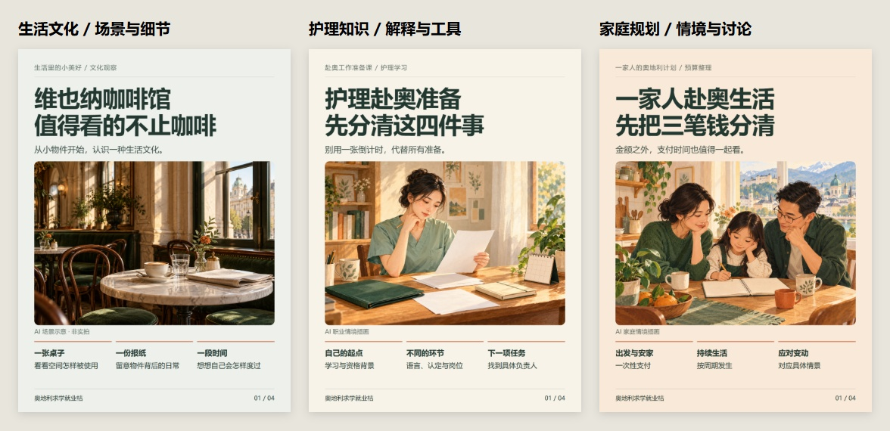
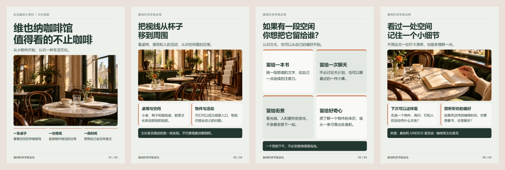
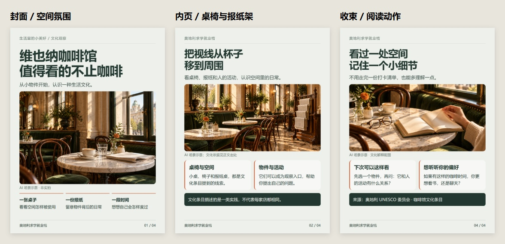

# 奥地利求学就业桔 · 自媒体内容创作 Skill

**把奥地利的生活讲得有画面，把学习、工作和家庭准备讲具体。**

面向“奥地利求学就业桔”的中文自媒体创作助手：将品牌定位、内容研究、创意表达、AI 配图、图文制作与审核串成可复用的工作流程。以小红书完整图文为重点，兼顾抖音、视频号的无露脸视频脚本、数字人讲解与跨平台改编。

定位：**奥地利学习、就业与家庭生活规划咨询**。通过具体、有用、好看的内容吸引了解与交流，在读者主动咨询后如实衔接服务。

[效果示例](#showcase) · [核心能力](#capabilities) · [快速使用](#start) · [视觉与页数](#visual) · [来源与知识库](#sources) · [SEO/GEO](#search) · [本地出图](#renderer) · [文件导航](#files)

<a id="showcase"></a>
## 先看实际图文效果



目前提供 **3 套完整样稿、共 12 页**，包含实际 AI 配图、可编辑排版输入及发布文案。每套 4 页用于演示，后续作品按内容决定张数。

| 样稿 | 内容组织 | 可编辑输入 |
|---|---|---|
| 生活文化 | 咖啡馆场景 → 物件与空间 → 活动偏好 → 自然交流 | [culture.json](assets/editorial/culture.json) |
| 护理准备 | 区分准备环节 → 对照解释 → 资料工作表 → 下一项任务 | [nursing.json](assets/editorial/nursing.json) |
| 家庭生活 | 预算分类 → 生活假设 → 支付节奏表 → 家庭讨论 | [family.json](assets/editorial/family.json) |

图中人物和场景为 AI 示意，已在成品标识，不是实拍或真实客户案例。文化事实另有出处；护理与家庭样稿以准备方法为主，不提供个案资格结论。

<details>
<summary>展开查看：一篇四页图文的完整阅读流程</summary>



此图展示同一篇的全部四页；实际交付仍为可分别上传的独立图片。源文件与配图说明见 [完整设计资源](assets/editorial/README.md)。

</details>

<a id="capabilities"></a>
## 从一个主题到完整内容

| 能力 | 实际能做什么 | 交付或资源 |
|---|---|---|
| 选题与创意 | 按读者背景、具体问题与内容目标设计切口、标题、结构和系列；有历史作品时比较重复点 | 选题、标题、创作简报与系列规划 |
| 小红书完整图文 | 组织每页信息，制作封面和内页，组合图片、解释、对照、表格与步骤 | 独立图片、匹配组图的标题、含 emoji 正文、话题、预览及可编辑源 |
| 按任务选择配图 | 按逐页文案选择 AI 照片感、艺术插画、轻漫画、图解、授权实拍或原始资料；保持同套视觉一致 | 配图选择、生成提示词与成图记录，图像生成依赖可用工具 |
| 资料型原创 | 从实际可读的国内外内容中提炼问题与表达方法，重新核对事实并独立组织 | 来源记录、独立解释、图解和实用内容 |
| 专业内容审核 | 区分护理教育、认定、注册、录用及许可；核对家庭规划涉及的对象、日期和条件 | 主张与出处核对、公开稿改写 |
| 视频与跨平台改编 | 为无露脸视频、数字人讲解编写时间、旁白、画面、字幕和素材要求 | 可制作脚本；成片与可编辑工程另需实际制作工具 |
| 自然互动与反馈 | 设计贴合本篇的评论问题和回复草稿，从真实评论与后台资料提取后续选题 | 互动草稿、观察、改动假设和下一版建议 |
| 每日本地历史与查重 | 逐日记录实际生成内容，查相同正文、页面文字、高度重合及相同源图；结合人工判断语义增量 | 仓库外本地台账、相近作品报告，记录不上传 GitHub |
| 局部修改与版本保护 | 只改指定页、保留已确认内容、另存版本并核对未改页 | 新版本及改动记录；渲染工具支持指定页更新 |

适合自有实拍、采访与案例素材有限的团队。原创可以来自问题、解释、练习、叙事和设计；不需要假装亲历，也不编造成功案例。创作本身不授权发布、回复评论、发私信或收集客户资料。

## 三个长期内容方向

| 方向 | 可以持续展开的内容 | 读者价值 |
|---|---|---|
| 奥地利美好生活、文化与工作体验 | 城市与季节、咖啡馆、艺术、亲子日常、工作之外的生活，以及有依据的生活和工作优势 | 看见具体生活、产生好奇与交流；允许纯欣赏内容 |
| 护理学习与职业准备 | 相关专业在读及毕业学生、已有资格青年各自的语言任务、课程与实践记录、职业概念、岗位阅读 | 认清自己的阶段，完成一项具体准备；其他职业另核对应条件 |
| 家庭教育与生活规划 | 家庭共同目标、孩子学习、预算、现金流、生活适应与日常活动 | 帮助家人讨论和逐步查清问题，不用人群标签替代资格判断 |

三个方向共同构成账号，不设固定内容比例、周更数量或每篇必带的销售结尾。生活文化拥有独立的审美与知识价值；专业内容也应给出具体解释，避免反复停留在“先核对、因人而异”。

<a id="start"></a>
## 快速使用

1. 下载完整仓库，保留 `SKILL.md`、`references/`、`assets/` 等相对目录。
2. 按所用客户端的方式加载整个 Skill 文件夹。没有导入入口时，让能读取本地文件的 Agent 先读 [SKILL.md](SKILL.md)，再按任务读相关资料。
3. 给出主题、读者和希望的形式。明确只要选题、文案、审核或单页修改时，就按该范围执行；只给主题且无形式要求时，默认小红书完整图文。

```text
用 $austria-study-career-content
围绕“维也纳咖啡馆，值得看的不止咖啡”制作一篇小红书完整图文。
面向对奥地利生活好奇的读者，用实际可读来源独立解释，不假装亲历。
页数按内容安排。按每页任务自动选择配图媒介，同套底色统一，逐页使用不同的关联画面，适量加入 emoji。
交付独立图片、标题正文、话题、整套预览和可编辑源。
```

也可以直接提出单项任务：

- **护理内容：**“为护理专业在读学生设计一篇资料整理方法图文，讲清不同准备环节，避免结果承诺。”
- **家庭内容：**“把家庭赴奥生活预算做成可讨论的图文，区分支付周期和未知项，不编当地报价。”
- **系列创意：**“根据来源库设计 8 个生活文化选题，写清每篇新增信息，先不排固定日程。”
- **局部修改：**“只修改第 2 页的配图，保持人物、画风和配色，换一个贴合本页的新场景；其余页保留。”
- **视频改编：**“把这篇图文改成 45 秒无露脸视频脚本，交付时间、旁白、画面、字幕和素材清单。”

Skill 提供方法、资源和本地图文工具；联网查证、AI 出图、视频制作需由执行环境提供对应能力。只凭 Skill ID 不能假定已安装或已有这些工具。

<a id="visual"></a>
## 视觉统一，每一页都有变化



**图片风格跟着内容走。** 用照片感表现生活，用插画突出场景或动作，用轻漫画呈现对话，用图解呈现比较、步骤和数据。涉及真实地点、学校或材料时，按可核验出处与使用权选素材，AI 场景在成品上标明示意。[逐页媒介选择表](references/xiaohongshu-styles.md)

例如，家庭赴奥准备可以用街区散步做照片感封面，办公近景讲工作安排，桌面静物配收入计算卡，最后用讨论表收束。全套统一画布底色、字体层级和强调色。

**同套生成主图不重复。** 保持画风、配色、光线与必要的人物特征，按页生成不同场景、动作、物件与构图。裁切、放大、镜像、调色或改文件名不算新图；近乎相同的变体也需要调整。制作前列配图清单，完成后看整套图片检查统一性与差异。

**页数由内容决定。** 当前规范通常先考虑 4—7 页，简单主题可以更短，这只是试排起点。每页完成一个任务：内容不足就补具体解释或合并，信息拥挤就删减或拆页；不靠稀疏短句凑页数，也不强制每页配图。

**五种风格按主题组合。** 编辑式清单、温暖生活插画、实景感编辑、材料解读、路线与比较图解，表示可延伸的视觉方向。正式制作优先参考当前完整样稿，封面、图文解释、对照卡、工作表和步骤页分别设计。关键中文、数字、品牌与来源采用可控文字，AI 图片和 emoji 辅助表达。

<details>
<summary>查看早期五种风格封面 DEMO</summary>

[打开五风格封面探索图](docs/images/style-comparison.jpg)。它展示五种方向，不代表五套复杂艺术设计已全部实现自动化。旧 [基础输入](assets/examples/README.md) 保留用于技术回归或明确要求的极简任务，不是正式内容的默认视觉质量线。

</details>

具体要求见 [视觉制作与验收](references/visual-production.md)、[小红书制作指南](references/xiaohongshu-production.md) 与 [风格库](references/xiaohongshu-styles.md)。

<a id="sources"></a>
## 有知识基础，也有持续找题的来源

- [护理职业知识库](references/knowledge-nursing-career.md)：按读者起点组织职业层级、教育、认定、语言、注册、岗位与准备。
- [家庭居住规划知识库](references/knowledge-family-residence.md)：区分目标、条件、材料、年度节点、工作限制与后续安排。
- [生活文化内容卡](references/knowledge-lifestyle-culture.md)：提供文化出处、观察角度与可展开的内容切口。
- [国内外内容参考来源库](references/source-library.md)：收录文化、生活、职业及护理/家庭规划相关的机构、媒体与专题，标明直达链接、可见范围和使用边界。

来源库在 **2026-11-02 的核验记录中有 21 项来源：19 项实质正文、2 项部分可读**。这是带日期的访问记录，使用时仍需打开本次具体页面；不把登录页、空壳主页或搜索摘要当作已经读过的内容。

原平台不可读时，有限查找同机构官网、其他官方平台或具体文章；仍无相关正文则移出活跃来源。参考内容启发问题和表达，专业事实回到对应原文核验，图片与视频另查使用权。公开可读不等于允许转载。

**来源 → 读者问题 → 事实核验 → 独立组织 → 设计制作 → 审核。** 不逐句翻译或换词搬运，不把他人的经历变成本品牌案例。来源库需要维护，不自动后台采集；知识卡和历史政策快照也不是实时数据库。

<a id="search"></a>
## SEO/GEO：让内容更容易被理解与检索

围绕真实查询意图，明确“奥地利/城市、人群、问题、答案与条件”，自然组织标题、正文和话题。术语首次解释，中文、德文/英文名称与缩写保持对应；正文保留必要文字，不能只把重要信息写进图片。

知识解释尽量包含清楚的对象、结论、适用条件和来源，方便读者理解，也让可被访问的内容更便于检索与引用。平台内搜索、公开网页 SEO 和生成式回答的引用分别判断；未观察的数据只作候选，不编热搜、搜索量或竞争度，不承诺排名、收录、AI 引用或咨询增长。方法见 [编辑生产方法](references/editorial-production.md)。

## 本地记录每天创作，减少重复选题

本地历史功能记录完成时间（上海时区）、标题、正文、页面内容、配图摘要及输出位置。制作前先查历史，成稿后检查重复和高度相似内容，成功导出后自动登记。只换标题、标点或 emoji 不能避开相同正文；同题新解释可以继续，由 Agent 对照历史确认增量。

```sh
node scripts/content-history.cjs list
node scripts/content-history.cjs list --date 2026-11-03
node scripts/content-history.cjs check --input assets/editorial/culture.json
```

默认存储于用户主目录的 `.austria-study-career-content/history/`，可通过环境变量 `AUSTRIA_CONTENT_HISTORY_DIR` 或忽略上传的 `history.local.json` 指定共享目录。代码会上传 GitHub，实际记录和本机配置不上传。换电脑需迁移本地台账；首次空库不能代表已查全部历史作品。

内置图文渲染器自动查重并登记，其他工具完成的文案、选题或视频脚本由 Agent 调用 `record` 登记。修改版沿用作品编号、保留旧记录；用户明确要求重复时记录原因。词面相似算法不能识别所有同义改写，不保证全网或全账号零重复。详见 [本地历史使用与边界](references/content-history.md)。

## 从创作到交付如何把关

确认范围与工具素材 → 查来源和主张 → 初审事实与公开用词 → 成稿及逐页任务 → 选配图媒介与整套设计 → 实际制作 → 内容、视觉分别验收 → 交付与版本记录。

每套按实际图片单独写标题、含 emoji 的正文和相关标签，并检查主题、数字与条件的一致性。普通图文采用本地保守预算：标题 20 个 UTF-16 单元、正文合并话题与换行后 1000 单元；通常选 4—6 个相关话题，本地编辑上限 8 个。该计数不是平台算法，话题数量建议也不等于官方硬上限，发布前按当前界面复核。详见 [字段依据与复制规范](references/xiaohongshu-publish-fields.md)。

小红书完整发布包包含：

```text
post/
  images/          封面和全部内页，按顺序单独上传
  publish.md       可审阅的标题、正文与话题
  publish-title.txt 仅标题，复制到标题栏
  publish-body.txt  正文与一次话题串，复制到正文栏
  publish-topics.txt 单独话题串，按需使用，勿重复追加
  publish-check.json 内部字段计数，不粘贴到平台
  preview.jpg      整套预览
  source/          可编辑排版、输入与必要素材
  manifest.json    本地渲染时生成的文件摘要与检查记录
```

内容审核看标题是否兑现、是否有新增价值、事实和条件是否对应；视觉审核看原图与 360—420 像素宽的可读性、构图、裁切、配图差异和整套节奏。来源与制作记录不混进可复制正文。

自动测试检查输入、图片导出、溢出、素材保存、源文件迁移、指定页修改与样稿素材去重；不能替代语义、审美、事实审核和真实发布反馈。本地发布包检查通过不等于已上传平台。视频另需真实导出与播放验证。

<a id="renderer"></a>
## 本地图文导出与指定页修改

需要 **Node.js 20+、Playwright、可用的 Chromium 系浏览器和中文字体**。仓库附静态图文渲染脚本，不附浏览器、字体或 `node_modules`；脚本组合已有素材，不负责调用 AI 出图。

在仓库根目录执行以下命令，安装依赖并导出附带的家庭样稿：

```sh
npm install
node scripts/render-post.cjs --input assets/editorial/family.json --out output/family-editorial-v01
```

安装依赖需要联网。已有环境可用 `PLAYWRIGHT_MODULE_PATH` 指向模块目录，`BROWSER_EXECUTABLE` 或 `--browser` 指向实际存在的 Chrome/Edge。默认浏览器未准备时，先安装对应浏览器或配置已有路径；配置保存在本机。

先修改指定页 JSON，再导出独立新版本：

```sh
node scripts/render-post.cjs --input assets/editorial/family.json --out output/family-editorial-v02 --base output/family-editorial-v01 --pages assumptions
```

未选页保留原图并核对摘要。更换页序、全局设置或渲染器时需完整导出；输出目录必须不存在。支持 UTF-8 BOM、未知字段报错、图片适配与溢出拒绝。输入未提供 `publish` 时只导出图片制作包。详见 [制作工具指南](references/production-tools.md)。

```sh
npm test
```

默认执行非浏览器检查；设置 `RUN_RENDER_TESTS=1` 启用浏览器导出检查，可配合上述模块及浏览器环境变量。当前包含三套正式样稿与五类基础回归输入；技术检查通过不代表画面、政策或平台效果已自动验证。

## 专业准确、自然表达与真实服务

公开内容以学习、职业、家庭和生活知识为主，表达友好、具体、低销售感，不强推办理路径或结果。内部知识保留准确名称；公开解释不因避词改变条件，也不把“不出现某个词”写成不限流保证。

护理教育、资格认定、职业注册、雇主录用、就业许可与居留分别解释。涉及语言等级、薪资、费用、年度节点或跨国权利时，核对本次适用规则和对象；不承诺包过、包就业、快速永居或全欧盟无条件就业。咨询阶段如实说明实际服务范围、责任和费用。

客户材料、内部报价、合作证明和未公开案例留在私有工作区，不进入公共仓库。可选本机配置 `service-context.local.json` 只用于指向用户指定的私有简报。详见 [公开表达规范](references/public-expression-rules.md)、[证据审核](references/evidence-review.md) 与 [咨询衔接](references/consultation-and-positioning.md)。

<a id="files"></a>
## 按任务查找文件

| 任务 | 文件入口 |
|---|---|
| 开始使用与品牌口径 | [SKILL.md](SKILL.md)、[品牌标准](references/brand-standard.md)、[文案标准](references/brand-copy.md) |
| 选题、系列、搜索与跨平台 | [受众与选题](references/audience-and-topics.md)、[编辑生产方法](references/editorial-production.md)、[创意指南](references/creative-playbook.md) |
| 生活文化与自然互动 | [生活文化内容卡](references/knowledge-lifestyle-culture.md)、[生活文化与互动](references/lifestyle-culture-engagement.md) |
| 专业知识与查证 | [护理知识](references/knowledge-nursing-career.md)、[家庭知识](references/knowledge-family-residence.md)、[来源库](references/source-library.md)、[证据审核](references/evidence-review.md) |
| 小红书设计与配图 | [完整制作指南](references/xiaohongshu-production.md)、[发布字段规范](references/xiaohongshu-publish-fields.md)、[风格库](references/xiaohongshu-styles.md)、[视觉验收](references/visual-production.md)、[正式样稿与素材](assets/editorial/README.md) |
| 图片导出、修改与检查 | [制作工具](references/production-tools.md)、[渲染脚本](scripts/render-post.cjs)、[回归测试](tests/renderer.test.cjs)、[版本与私有资料](references/revision-and-private-data.md) |
| 视频与数字人 | [视频交付规范及脚本示例](references/video-production.md) |
| 评论、数据与后续咨询 | [本地历史](references/content-history.md)、[素材与反馈](references/materials-and-feedback.md)、[咨询衔接](references/consultation-and-positioning.md) |

## 使用范围与维护

本 Skill 为品牌内容创作提供标准与资源，不是奥地利官方服务，也不替代个案法律判断。外部页面、政策、费用和活动会变化，使用时按具体主张重新核验。没有真实后台数据时，不声称已经提升流量、评论或获客。

仓库未附通用开源许可证；公开展示不等于授予品牌与素材自由再分发权。反馈请附相关输入、文件和预期差异，并去除敏感资料。
