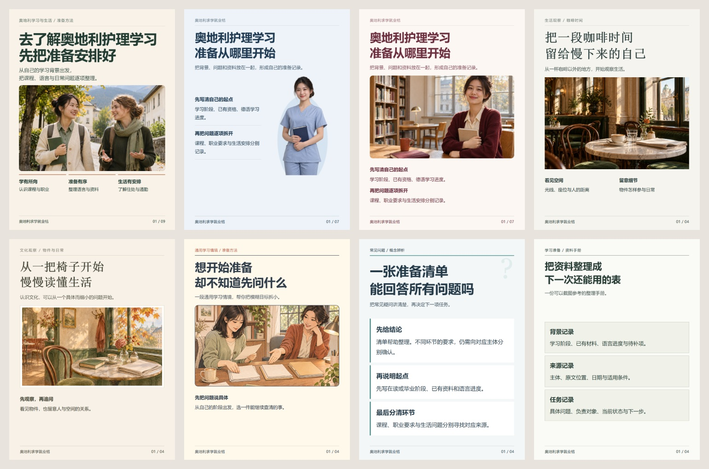
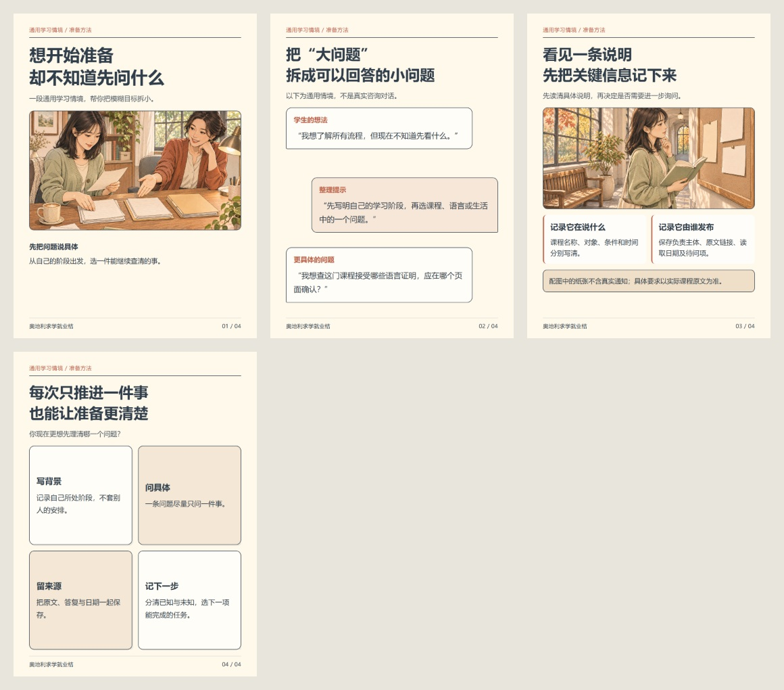

# 奥地利求学就业桔 · 自媒体内容创作 Skill

**把奥地利生活讲得有画面，把学习、工作和家庭准备讲具体。**

为「奥地利求学就业桔」提供可复用的中文内容生产流程：资料研究、选题、文案、配图、图文设计、审核与本地版本管理。重点制作小红书完整图文，也支持无露脸视频脚本、数字人讲解脚本和跨平台改编。

定位为**奥地利学习、就业与家庭生活规划咨询**。用具体、有用、好看的知识与生活内容吸引理解和交流，读者主动咨询后如实衔接服务；不强制每篇带销售结尾。

[八套模板](#templates) · [八个信息方向](#directions) · [核心能力](#features) · [快速使用](#start) · [生产验收](#quality) · [知识来源](#sources) · [本地工具](#tools) · [文件导航](#files)

<a id="templates"></a>
## 八套实际设计模板



**8套可运行输入，共43页示例**，每套附匹配图片的发布标题、含适量emoji正文、话题和可编辑源。T1—T3延续用户认可的护理陪伴版、7页完整重设计与护理精排版；T4—T8扩充不同视觉表达。页数由实际内容决定，示例数量不构成固定要求。

| 编号 | 模板 | 主要视觉特征 | 实际输入与预览 |
|---|---|---|---|
| T1 | **温暖陪伴叙事** | 暖米白深绿、场景照片、图文解释与叙事推进 | [输入](assets/templates/t1.json) · [9页](docs/images/template-t1.jpg) |
| T2 | **雾蓝完整编辑** | 人物文字分区、雾蓝体系、条带比较与步骤卡 | [输入](assets/templates/t2.json) · [7页](docs/images/template-t2.jpg) |
| T3 | **暖白酒红精排** | 连续段落、舒适行长、宽栏组件与横向面板 | [输入](assets/templates/t3.json) · [7页](docs/images/template-t3.jpg) |
| T4 | **生活摄影杂志** | 大幅照片、方形画框、宋体标题、照片与说明交替 | [输入](assets/templates/t4.json) · [4页](docs/images/template-t4.jpg) |
| T5 | **文化艺术画册** | 水彩画面、纸感配色、细框、书卷式章节 | [输入](assets/templates/t5.json) · [4页](docs/images/template-t5.jpg) |
| T6 | **轻漫画情境** | 细腻线稿、情境分镜、交替对话框、温暖配色 | [输入](assets/templates/t6.json) · [4页](docs/images/template-t6.jpg) |
| T7 | **问答专题编辑** | 问题主导封面、清楚答案、分层解释与条件 | [输入](assets/templates/t7.json) · [4页](docs/images/template-t7.jpg) |
| T8 | **实用资料手册** | 清晰表格、字段示例、规则线与注释 | [输入](assets/templates/t8.json) · [4页](docs/images/template-t8.jpg) |

模板的区别来自构图、图片角色、文字节奏与页面组件。摄影杂志用大幅照片和细节观察；艺术画册使用独立水彩画面；轻漫画通过场景和交替对话推进；问答版强调答案与解释；资料手册提供可回用的字段和表格。T7/T8可以以文字与原生图解为主。

T7/T8原版没有场景配图是有意安排，另提供[问答带图版](docs/images/template-t7-illustrated.jpg)和[手册带图版](docs/images/template-t8-illustrated.jpg)两个完整变体，共8页，保留原版内页。是否配图按本篇的解释与场景任务选择，避免长期只有文字，也不为凑图塞无关风景。

新补充四张独立艺术/漫画画面；同套多图使用不同场景，保持色调和必要的人物特征。全部生成场景不作客户、学校、医院、房源、合作或文化史证明。[模板选用与精排](references/selected-templates.md) · [素材说明与提示词](assets/templates/PROMPTS.md)

<details>
<summary>查看轻漫画完整四页与原有题材样稿</summary>



原有[生活文化、护理准备、家庭预算三套题材样稿](assets/editorial/README.md)继续保留，共12页；它们展示不同题材，独立于八套视觉模板。旧五类基础输入仅作兼容和技术回归，不是正式图文默认的视觉完成度。

</details>

<a id="directions"></a>
## 八个信息方向，决定内容怎样讲清楚

**S编号负责内容逻辑，T编号负责视觉，照片、插画、漫画和图解属于媒介。** 可以组合使用，但不宣称64种搭配全部经过独立验证。

| 编号 | 信息方向 | 读者要解决的问题 | 常见展开方式 |
|---|---|---|---|
| S1 | 分类清单与实用指南 | 复杂事项怎样拆成可使用的项目 | 分类→优先级→具体字段→行动 |
| S2 | 生活情境与选择讨论 | 一个具体处境下有哪些顾虑与选择 | 情境→不同顾虑→解释→选择 |
| S3 | 细节观察与生活发现 | 画面里哪些细节值得看见 | 全景→物件/动作→关系→个人观察 |
| S4 | 原文解读与证据说明 | 一份具体原文究竟说了什么 | 原文定位→含义→对象与条件→待确认项 |
| S5 | 路径比较与过程拆解 | 选项有何差异，步骤如何关联 | 对齐维度→比较→依赖关系→下一步 |
| S6 | 问题解答与概念辨析 | 这个问题的答案是什么，概念有何区别 | 具体问题→直接回答→解释/例子→适用条件 |
| S7 | 主题深描与叙事推进 | 一个主题或过程如何逐步展开 | 主题入口→阶段/变化→解释→完整收束 |
| S8 | 文化溯源与意义解释 | 一种现象从何而来，今天意味着什么 | 文化现象→来源与演变→当下实践→意义 |

每篇选择一个主方向，按需辅助一个。生活观察可以止于欣赏与交流；文化溯源需要对应资料；问题解答先给清楚答案；主题叙事不依赖虚构客户案例。S2/S3沿用旧编号并校正名称，避免把画风和信息分类混用。[方向边界与选择](references/xiaohongshu-styles.md)

## 根据内容辅助自动匹配

Agent先把主任务、文字密度、媒介、证据与图片任务写成内部简报，选择器生成主方向、模板、候选理由、备选及素材缺口。近期使用的模板只作轻度调整；明确选择、长文阅读和真实证据优先。CLI默认只读本地明确记录的模板元数据，不猜测未记录的历史，不扫描账号或聊天。

```sh
node scripts/select-design.cjs --input assets/templates/selection-example.json
```

输出是制作建议，不是成品。Agent将方案写入实际输入、取得素材并试排，仍需逐页目视检查；不宣称分数代表审美概率或64种搭配全部验证。[选择字段与配图规则](references/design-selection.md) · [本次检查与修复](docs/design-audit.md)

<a id="features"></a>
## 从主题到内容成品

| 能力 | 实际做什么 |
|---|---|
| 选题与内容创意 | 明确读者问题、来源、切口与每页新增信息，形成独立解释、观察或实用内容 |
| 原稿照排与润色 | 区分照排、保留信息润色和编辑重写；建立原稿到上版内容对照，保护数字、条件与服务范围 |
| 小红书完整图文 | 制作独立封面和内页，交付匹配组图的标题、正文、话题、整套预览与可编辑源 |
| 媒介与版式选择 | 根据页面任务选照片感、艺术插画、轻漫画、原生图解、授权实拍或原始资料 |
| 精排与品牌识别 | 调整行长、断行、组间距、图文对齐和视觉重心；每页页尾保留账号昵称 |
| 来源研究与专业审核 | 阅读具体资料，核对对象、日期与适用条件；不搬运原文或编造经历 |
| 自然评论与反馈 | 提出本篇具体、易回答的问题，根据实际评论或后台资料提出后续选题 |
| 视频与跨平台改编 | 提供无露脸视频/数字人脚本、时间、画面、字幕和素材需求；成片另需实际制作工具 |
| 本地历史与版本 | 每日记录、重复检查、关联改版、指定页保护；实际记录留在仓库外 |
| 技术与交付检查 | 核对实际页面文字、裁切、完全重复源图、品牌页尾、文件摘要与发布复制文案 |

适合原创实拍、采访和案例素材有限的团队。内容可以来自独立问题、资料解释、比较、工具表、生活观察和创意设计，不需要把他人的经历改成自身案例。

## 三个长期内容支柱

- **奥地利美好生活、文化与工作体验**：城市、季节、咖啡馆、艺术、亲子日常与有依据的生活和工作优势。允许纯欣赏与文化内容。
- **护理学习与职业准备**：区分在读、毕业及已有资格的起点，解释语言、课程、认定、职业概念、资料与岗位；其他职业另核。
- **家庭教育与生活规划**：家庭目标、孩子学习、预算、支付节奏和生活适应，不以人群标签代替资格判断。

不设固定周更数量、内容比例或每篇必带的销售结尾。专业页提供具体信息，生活页有画面与细节，避免只有泛泛标题或重复提醒。

<a id="start"></a>
## 快速使用

下载完整仓库，保留SKILL.md、references/、assets/和scripts/相对目录，按客户端方式加载整个文件夹。没有导入入口时，让能读取本地文件的Agent先读[SKILL.md](SKILL.md)。只凭名称不能假定已安装或具备出图与联网能力。

```text
用 $austria-study-career-content
采用S3细节观察与生活发现、T4生活摄影杂志。
制作一篇奥地利生活相关的小红书完整图文，内容具体，页数按实际安排。
同套底色统一，配图逐页不同，保留舒适留白。
每页页尾写“奥地利求学就业桔”。
交付实际图片、匹配的标题正文话题、整套预览与可编辑源。
```

原稿改版也可直接说：

```text
采用T3暖白酒红精排设计我提供的原稿。
允许润色，但不要增加或减少信息，先建立内容对照。
完整保留数字、条件和服务范围，重点优化文字与图片的间距和断行。
每页页尾保留奥地利求学就业桔。
```

只要选题、文案、审核、提案或单页修改时，按指定范围执行。常规设计选择由Agent结合内容判断，不强制用户先选全部编号。

<a id="quality"></a>
## 精致、舒展与内容丰富，分别落实

**内容丰富**体现在整篇有具体收获：分类、解释、例子、观察、可填写字段或可推进任务。每页有新增价值；短主题可以更短，不用稀疏句子撑页数，也不为填版新增未经核验信息。

**阅读舒服**体现在清楚的层级、适当行长、自然断行与信息分组。正文左对齐，避免大字缝、孤字、括号或币种拆散；长条件换宽栏或拆页。图片与文字沿内容网格对齐，减少无意义边框和装饰。画面主导页和密集信息页形成节奏。

**每页页尾固定署名：奥地利求学就业桔。** 封面、全部内页和末页都保留，采用可控文字层。渲染器逐页核对文字、页尾安全位置、裁切与至少22px字号；这是技术下限，成图仍检查对比、遮挡和手机阅读。

工作流程：确定范围与保护项 → 查看历史 → 读取原稿和来源 → 核验主张 → 原稿对照与逐页任务 → 选择信息方向、模板及媒介 → 制作素材与排版 → 导出 → 原图、手机预览与整套节奏检查 → 发布字段核对 → 最终包检查 → 本地版本记录与交付。

原稿到定稿按信息单元核对；定稿到图片由输入与实际DOM文字比对辅助，段数相同不证明语义完整。包检查核对源HTML、JSON、文字审计、源素材、导出图片与可复制文案，发现改了源码却未重新出图等问题。[原稿完整性](references/manuscript-fidelity.md) · [质量检查](references/production-quality.md)

同套场景主图不能完全重复，裁切、调色、镜像或改文件名不算新图。工具按源内容哈希拦截完全重复，近似画面仍需人工判断；必要证据复用须明确资料角色与用途。八套模板不保证所有内容自动排得美观，仍要按实际稿件试排和检查。

## 发布文案与标识

每套完整笔记分别提供匹配图片的推荐标题、含适量emoji正文和相关话题。普通图文使用本地保守预算：标题20个UTF-16单元，正文连话题和换行1000单元；通常4—6个相关话题，本地编辑上限8个。它不是官方计数器或永久平台规则，投稿前按当前界面核对。[发布字段规范](references/xiaohongshu-publish-fields.md)

成品图片和可复制文案不自动添加「AI示意」「AI生成」等来源字样。素材对应和声明提醒留在内部，由团队发布时手动添加平台声明；保留工具/平台要求的已有标识。

<a id="sources"></a>
## 专业知识与持续内容来源

| 知识入口 | 用途 |
|---|---|
| [护理职业知识库](references/knowledge-nursing-career.md) | 教育、认定、语言、注册、岗位与准备分别解释 |
| [克恩顿护理专题](references/knowledge-nursing-carinthia.md) | 地区教育资料、主张核验与公开表达边界 |
| [家庭居住规划知识库](references/knowledge-family-residence.md) | 目标、条件、材料、节点、工作限制与后续安排 |
| [生活文化内容卡](references/knowledge-lifestyle-culture.md) | 文化出处、观察方法与内容切口 |
| [国内外来源库](references/source-library.md) | 按实际可见范围选择机构、媒体、网站与专题 |

来源库和政策快照是带日期记录，不是实时数据库。每次使用打开具体页面；不可读时有限寻找同机构其他可读渠道，仍无实质正文则不作当前依据。借鉴问题与表达方法，事实回到负责机构原文，图片视频另查权限；公开可读不等于可以搬运。

护理教育、资格认定、职业注册、雇主录用、就业许可与居留分别判断。不承诺包过、包就业、快速永居或全欧盟无条件就业；不因避词改变真实条件或服务性质。

## SEO与GEO：让内容清楚、可回查

围绕真实读者问题，自然说明地区、对象、事项、结论与适用条件；中文、德文名称及缩写保持对应。必要文字同时进入发布正文，不把全部信息只放图片。

清晰答案、独立解释和可追溯出处便于理解与引用；平台搜索、公开网页SEO和生成式回答引用分别判断。不编热搜、搜索量与竞争度，不承诺排名、收录、AI引用或咨询增长。[编辑方法](references/editorial-production.md)

<a id="tools"></a>
## 本地制作、查重与版本工具

需要Node.js 20+、Playwright、可用的Chromium系浏览器和中文字体。仓库不附浏览器、字体或node_modules；渲染器组合已有本地素材，不负责联网取图或调用图片生成。联网核验、图片和视频生成由执行环境提供。

```sh
npm install
node scripts/render-post.cjs --input assets/templates/t7.json --out output/t7-v01
node scripts/audit-package.cjs output/t7-v01
```

安装依赖需要联网。已有环境可用PLAYWRIGHT_MODULE_PATH、BROWSER_EXECUTABLE或--browser配置模块与实际Chrome/Edge路径，不将本机绝对路径写入公共代码。输出目录必须不存在，采用新版本保护旧成品。

先改目标页JSON，再进行指定页修订：

```sh
node scripts/render-post.cjs --input assets/templates/t7.json --out output/t7-v02 --base output/t7-v01 --pages starting
```

未选页核对文字、素材与摘要并复制原图。公共渲染器、模板代码、配色或页序变化需完整重导。[字段与运行说明](references/production-tools.md)

完整输出包含images/、preview.jpg、source/、manifest.json；有publish输入时另输出publish.md、标题/正文/话题TXT及内部字段计数。正文TXT已包含一次话题串，独立话题文件按需使用，避免重复追加。

### 本地记录与内容去重

```sh
node scripts/content-history.cjs list
node scripts/content-history.cjs check --input assets/templates/t7.json
```

台账默认在用户主目录.austria-study-career-content/history/，可用AUSTRIA_CONTENT_HISTORY_DIR或忽略上传的history.local.json指定共享位置。按上海时区组织每日记录；内置渲染器成功导出后登记，其他形式在实际完成后调用record。视觉改版关联原作品，不冒充新选题。

查重结合正文、页面文字、源图片哈希和人工语义比较；换标题、emoji或配色不算增量。首次空库、换电脑未迁移记录或词面算法均不能证明全账号零重复。实际台账与本机配置不上传GitHub。[历史使用与边界](references/content-history.md)

### 测试与实际能力边界

```sh
npm test
```

默认运行非浏览器检查；设置RUN_RENDER_TESTS=1运行浏览器回归，覆盖八套模板、原有题材样稿、旧五类基础输入、可迁移源、指定页保护、重复图片、文件错配、页尾品牌与本地历史。技术通过不代替事实、审美或平台审核，也不代表已上传小红书。视频脚本不等于成片。

<a id="files"></a>
## 文件导航

| 任务 | 入口 |
|---|---|
| 开始使用与品牌 | [SKILL.md](SKILL.md)、[品牌标准](references/brand-standard.md)、[文案标准](references/brand-copy.md) |
| 八方向与八模板 | [方向指南](references/xiaohongshu-styles.md)、[模板指南](references/selected-templates.md)、[模板资源](assets/templates/README.md) |
| 结构化目录 | [方向目录](assets/information-directions.json)、[模板目录](assets/templates/catalog.json) |
| 图文流程与验收 | [制作指南](references/xiaohongshu-production.md)、[视觉规范](references/visual-production.md)、[质量检查](references/production-quality.md) |
| 原稿与版本 | [原稿完整性](references/manuscript-fidelity.md)、[修改和私有资料](references/revision-and-private-data.md) |
| 来源、生活与专业审核 | [来源库](references/source-library.md)、[生活文化](references/lifestyle-culture-engagement.md)、[证据审核](references/evidence-review.md) |
| 选题、反馈与衔接 | [受众选题](references/audience-and-topics.md)、[素材反馈](references/materials-and-feedback.md)、[咨询定位](references/consultation-and-positioning.md) |
| 本次升级与验证 | [八方向八模板方案](docs/eight-system-plan.md)、[验证记录](docs/validation.md) |

客户资料、内部报价、合作证明、未公开案例与每日记录保存在私有工作区。创作不自动授权对外发布、发私信或回复评论，具体咨询如实说明服务范围和责任。仓库未附通用开源许可证；公开展示不自动授予品牌及素材自由再分发权。
