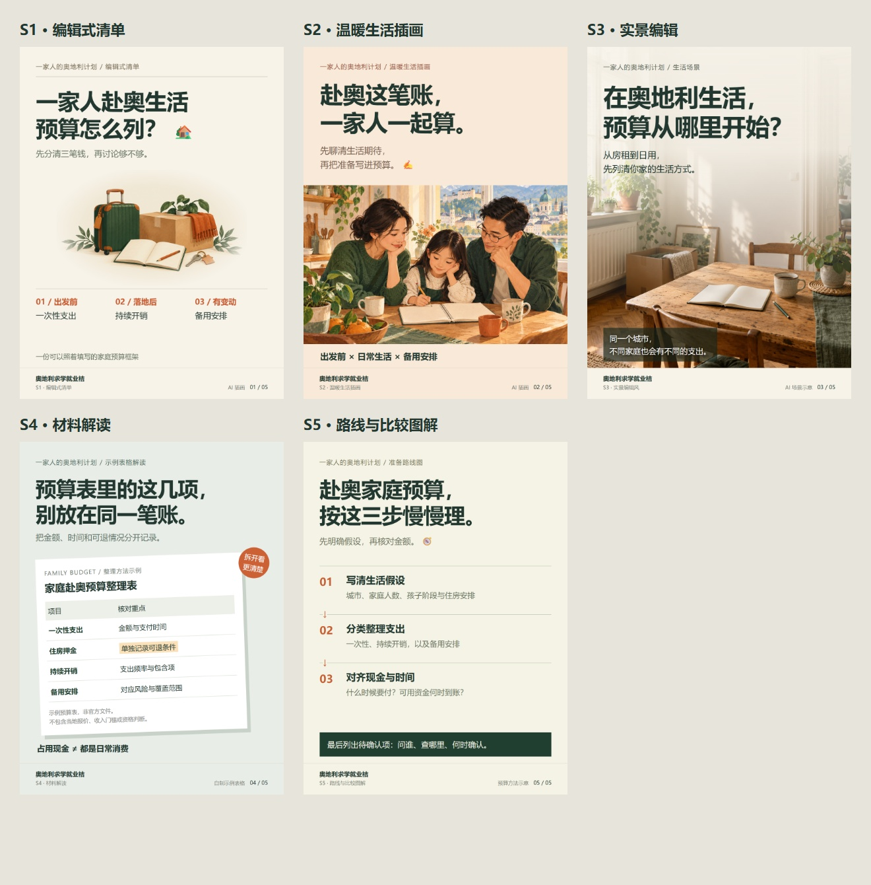

# 奥地利求学就业桔 · 自媒体内容 Skill

面向奥地利美好生活、文化、工作体验、护理职业与家庭教育规划的中文 AI 内容创作 Skill。支持小红书完整图文、抖音与视频号脚本、自然评论设计，以及发布前审核。

**让人看见生活、认识文化，再把工作与家庭规划讲具体。**

品牌定位：**奥地利学习、就业与家庭生活规划咨询**。公开内容以易懂的知识和真实场景建立信任，主动咨询后按实际服务范围进一步沟通。

`Skill ID: austria-study-career-content` · `版本：0.8.0` · `语言：简体中文为主`

[效果预览](#preview) · [内容方向](#content) · [快速开始](#quick-start) · [调用示例](#examples) · [本地出图](#renderer) · [常见问题](#faq)

## 这个 Skill 能帮你做什么？

将一个主题和已有素材，转化为有品牌辨识度、便于制作和检查的内容。统一事实与交付标准，同时为标题、叙事、图片和版式保留创意空间。

| 你要完成的任务 | 交付内容 |
|---|---|
| 小红书完整图文 | 封面、全部内页独立图片、发布标题、正文、话题、整套预览与可编辑源文件 |
| 奥地利生活文化展示 | 场景故事、主题组图、文化细节，以及与内容相关的自然评论问题 |
| 护理与家庭规划内容 | 按读者背景和准备阶段组织问题、资料与可执行步骤 |
| 无露脸视频或数字人脚本 | 分镜、时间安排、旁白、字幕、画面建议与资料插入点 |
| 已有作品改版 | 明确保留项与修改范围，按指定页调整并保留版本 |
| 审核与反馈分析 | 检查事实、语气、素材和承诺；根据实际数据提出下一版改动假设 |

**小红书默认以完整发布包为目标。** 图片生成和排版需要运行环境提供相应工具；仓库附带本地图文导出脚本。视频成片与可编辑视频工程需要另有实际制作工具，不能用脚本稿代替。

不规定每周发布数量，不强制内容比例，也不要求每篇都转向咨询。

<a id="preview"></a>
## 五种小红书视觉方向

以下是围绕同一“家庭赴奥预算”主题制作的五张实际封面 DEMO，便于比较不同表达方式。



| 风格 | 适用内容 |
|---|---|
| **S1 编辑式清单** | 预算、材料、准备事项与轻量生活指南 |
| **S2 温暖生活插画** | 家庭讨论、文化情境、亲子和生活选择 |
| **S3 实景编辑** | 日常观察、城市氛围、通勤与真实过程 |
| **S4 材料解读** | 政策、合同、学校通知、脱敏样本与证据说明 |
| **S5 路线与比较图解** | 准备顺序、不同选择、步骤关系与生活安排 |

可以指定风格，也可以让 Skill 按主题选择。构图、图片和叙事可以变化，品牌识别与阅读标准保持一致。适度融入匹配的 AI 插画与 emoji，资料密集页则保持清楚简洁。

演示中的摄影风场景已标明 AI 示意，预算表为自制示例。五张封面不等于五套完整内页模板，也不是传播效果证明。见[小红书风格库](references/xiaohongshu-styles.md)。

<a id="content"></a>
## 内容方向

### 长期内容支柱：美好生活、文化与工作体验

面向对奥地利感到好奇、尚未明确赴奥计划的读者。内容可以有画面、有情绪、有趣，也可以只负责让人留下具体印象。

这一方向长期保留，与专业知识共同组成账号内容。后续增加客户咨询或服务能力，不会将账号内容收窄为材料、考试与申请说明。单篇可以只负责好看、有趣、产生好奇和评论，不要求每篇带咨询入口。

六类栏目：**生活里的小美好、文化走近一点、工作之外的生活、一家人的日常、城市与季节印象、值得了解的好条件。**

评论问题从场景、偏好和好奇心出发，例如：“一个空闲下午，你更想去公园走走，还是找间咖啡馆坐坐？”不强行引导咨询，不伪造热评或承诺评论奖励。生活与工作优势有相应依据，个体体验不泛化为所有人的待遇。见[生活文化与互动指南](references/lifestyle-culture-engagement.md)。

### 护理职业发展：赴奥工作准备课

优先关注相关专业在读及毕业学生，也区分已有护理资格的青年。围绕学习背景、德语准备、资格与材料、岗位职责、合同及职业生活展开；在读与已毕业不能套用同一就业路径。根据读者处于初步了解、语言准备、资格衔接还是岗位比较阶段，调整内容深度。

### 家庭教育与生活：一家人的奥地利计划

围绕家庭目标、预算、现金流、孩子教育、申请准备与安家展开。帮助家人共同讨论具体问题，区分生活想象与实际条件。

这些方向可以逐步衔接“看见生活、产生好奇、提出问题、了解准备、主动咨询”，不要求同一篇完成全部过程。

<a id="quick-start"></a>
## 快速开始

**使用 Skill 创作，与运行本地出图脚本，是两种不同的使用方式。**

1. **获取完整仓库文件。** 保留 `SKILL.md`、`references/`、`agents/` 的相对目录关系，不能只复制入口文件。
2. **加载到支持 Skill 的 Agent。** 按所用客户端的导入方式加载整个文件夹。安装目录与刷新方式以该客户端说明为准。
3. **输入主题与目标。** 提供平台、读者、已有素材和想要的形式。明确只要选题或文案时，Skill 按该范围交付。

```text
用 $austria-study-career-content
制作一篇关于“家庭赴奥预算”的小红书完整图文。
采用 S1 编辑式清单，融入匹配的 AI 插画与少量 emoji。
交付封面和全部内页图片、发布标题正文、话题、预览及可编辑源文件。
不编当地价格，按信息量确定页数。
```

没有 Skill 导入入口时，可让能读取本地文件的 Agent 读取 [SKILL.md](SKILL.md)，再按链接读取相关参考文件。普通聊天界面需要同时提供主文件和相关资料，不能仅凭 Skill ID 假定已加载。

<a id="examples"></a>
## 可复制的调用示例

以下为任务示例，不是已核验的政策答案、实拍承诺或客户案例。

### 展示生活，让读者愿意交流

```text
用 $austria-study-career-content
围绕“奥地利的一个空闲下午”制作小红书完整图文。
面向暂时没有赴奥计划、但对当地生活好奇的人。
用具体场景和细节表达吸引力，加入一个容易回答的评论问题。
不强制转咨询；真实地点与文化事实需要核验，AI 场景清楚标识。
```

### 将职业主题做成易读图文

```text
用 $austria-study-career-content
为国内在职护士创作“赴奥准备，先整理什么”的小红书完整图文。
先比较三个不同切口，选一个完成图片与发布文案。
语气自然、专业，不把尚未核验的资格或语言门槛写成定论。
```

### 只改封面，保护已确认的内页

```text
用 $austria-study-career-content
基于我提供的上一版图文，只调整封面。
增加一幅匹配主题的温暖插画，标题与所有内页保持不变。
交付新版本，列出改动，并检查其余图片是否保留。
```

### 生成视频脚本或改编已有图文

```text
用 $austria-study-career-content
把我提供的图文改成45秒无露脸视频脚本。
保持事实与限制条件一致，重写开场和叙事节奏。
交付时间分段、旁白、字幕、画面与所需素材清单。
```

### 审核内容，或根据真实反馈改进

```text
用 $austria-study-career-content
结合我提供的稿件和发布数据，检查事实、品牌语气和读者疑问。
区分实际观察、可能原因与待验证假设。
推荐下一版只改变的一个主要因素，不编造缺失数据。
```

<a id="renderer"></a>
## 本地图文导出工具

[render-post.cjs](scripts/render-post.cjs) 将结构化 JSON 转成实际图片，适合复用清单、步骤、表格与分栏等基础布局。它不会自行创作内容、生成 AI 图片或渲染视频。

**运行要求：** Node.js 20+、Playwright，以及可用的 Chromium 系浏览器和中文字体。浏览器、字体与 `node_modules` 不随仓库附带。

在仓库根目录安装依赖后导出示例：

```sh
npm install
node scripts/render-post.cjs --input assets/post-example.json --out output/budget-v01
```

`npm install` 会联网下载声明的依赖。已有依赖可复用本机环境：用 `PLAYWRIGHT_MODULE_PATH` 指向 Playwright 模块目录，用 `BROWSER_EXECUTABLE` 或 `--browser` 指定真实存在的 Chrome/Edge 可执行文件。默认 Playwright 浏览器未安装时，需指定已有浏览器，或按 Playwright 说明准备浏览器。

输出目录必须是新目录。主要交付结构：

```text
budget-v01/
├── images/             独立 PNG，按发布顺序命名
├── publish.md          输入包含 publish 字段时生成
├── preview.jpg         整套预览
├── manifest.json       图片摘要与实际渲染页记录
└── source/             可编辑 HTML、JSON 及必要素材
```

编辑目标页的 JSON 后，可以只更新该页：

```sh
node scripts/render-post.cjs --input assets/post-example.json --out output/budget-v02 --base output/budget-v01 --pages once
```

未指定页面、全局设置或渲染脚本发生变化时，工具拒绝局部更新。未改页保留原始图片并校验摘要；过密内容触发溢出错误，不能静默截断后交付。

输入字段拼写错误会明确报错，支持带 BOM 的 UTF-8 JSON。升级渲染脚本后需完整导出新版本，不能直接把旧渲染版本作为局部更新基准。任务交付区分文案稿、待核验稿、导出待检查与本地检查完成，避免把已出文件误当成已审核或已发布。

已测试完整导出、本地图片与源文件迁移、指定页修改及未改页字节一致性等行为。导出后仍须目视检查，不能把自动检查等同于真机或平台上传验证。详细字段、依赖与测试方式见[制作工具指南](references/production-tools.md)。

## 专题知识库与公开内容规范

专业知识与公开表达分开维护：

| 模块 | 内容与作用 |
|---|---|
| [护理职业知识库](references/knowledge-nursing-career.md) | 8 组知识卡，覆盖读者起点、职业层级、认定、语言、注册、岗位、时间成本与常见误解 |
| [家庭居住规划知识库](references/knowledge-family-residence.md) | 8 组知识卡，覆盖家庭目标、许可性质、生活来源、材料、续期、年度节点及长期安排 |
| [公开表达规范](references/public-expression-rules.md) | 默认避用身份营销表达、不强推办理或商业产品，并明确必要事实解释的边界 |

知识卡保留正式名称、来源、适用对象、核验日期和更新触发条件。公开稿采用易懂的知识、生活文化和准备视角，不直接照搬政策或项目资料。必要条件不能因为避词而被省略；具体商业资料继续保存在私有工作区。

生活、文化、城市氛围、亲子日常和有依据的工作优势仍是长期内容支柱，不会因知识库增加而变成只有材料与申请流程的账号。

## 知识型内容与咨询服务

内容通过学习、德语、职业准备、家庭教育、文化与生活知识，让相关读者认出自己的问题。封面和推广不以“移民”“永居”等身份口号获客；必要政策解释仍使用准确名称，不能用咨询包装隐瞒真实服务或就业限制，也不声称避开某词即可规避限流。

具体客户服务、费用与合作主体由团队确认，并保存在用户指定的私有工作区，不随公开仓库分发。可选本地配置 `service-context.local.json` 可指向私有简报。公开内容、主动私信、正式咨询与交付的范围见 [定位与咨询衔接](references/consultation-and-positioning.md)。

政策时间、语言与长期居留等主张的本次核验见 [2026-10-30 政策快照](references/policy-snapshot-2026-10-30.md)，后续发布需再次核对。

## 事实、素材与品牌标准

- **品牌一致：** 保留“奥地利求学就业桔”的名称、定位与语气；创意可变，不擅自新增业务承诺。
- **正向表达有依据：** 区分审美感受、个体体验、文化事实与制度条件。生活展示可以轻松，关键条件仍需准确。
- **资料可追溯：** 涉及政策、资格、语言门槛、薪资费用或年度节点时，核对对应日期、对象和原始来源。
- **素材性质清楚：** AI 场景、数字人与示例材料不能充当真实经历、客户案例或政策证据。
- **公开与私有分离：** 客户材料、内部报价、合作证明和未公开案例保留在用户指定的私有工作区。

它提供内容创作与审核方法，不提供个案法律判断或结果保证。见[证据与审核](references/evidence-review.md)及[私有资料与版本规范](references/revision-and-private-data.md)。

## 文件导航

| 文件或目录 | 用途 |
|---|---|
| [SKILL.md](SKILL.md) | Agent 入口、任务路由与固定标准 |
| [brand-standard.md](references/brand-standard.md) | 品牌定位、读者、栏目与表达原则 |
| [audience-and-topics.md](references/audience-and-topics.md) | 受众阶段、选题优先级与去重 |
| [brand-copy.md](references/brand-copy.md) | 品牌文案正反例与改写标准 |
| [lifestyle-culture-engagement.md](references/lifestyle-culture-engagement.md) | 生活文化、工作体验与自然评论方法 |
| [creative-playbook.md](references/creative-playbook.md) | 内容结构、脚本与跨平台改编 |
| [xiaohongshu-production.md](references/xiaohongshu-production.md) | 完整图文制作、导出与检查 |
| [xiaohongshu-styles.md](references/xiaohongshu-styles.md) | 五种视觉方向、AI 插画与 emoji |
| [evidence-review.md](references/evidence-review.md) | 来源、条件、案例及承诺审核 |
| [revision-and-private-data.md](references/revision-and-private-data.md) | 局部修改、版本保留与私有资料 |
| [materials-and-feedback.md](references/materials-and-feedback.md) | 素材授权、证据维护与反馈分析 |
| [video-production.md](references/video-production.md) | 脚本、视频成片和工程交付标准 |
| [production-tools.md](references/production-tools.md) | 本地工具运行、输入与测试说明 |
| [post-example.json](assets/post-example.json) | 可运行的五页图文输入示例 |
| [renderer.test.cjs](tests/renderer.test.cjs) | 输入与浏览器集成测试 |
| [consultation-and-positioning.md](references/consultation-and-positioning.md) | 知识型公开定位、咨询衔接与私有资料读取 |
| [policy-snapshot-2026-10-30.md](references/policy-snapshot-2026-10-30.md) | 带来源的政策校准，含长期居留、护理和年度节点 |
| [knowledge-nursing-career.md](references/knowledge-nursing-career.md) | 护理学习与职业发展专题知识卡 |
| [knowledge-family-residence.md](references/knowledge-family-residence.md) | 家庭生活与配额居留相关专题知识卡 |
| [public-expression-rules.md](references/public-expression-rules.md) | 公开模式、默认避用表达、销售边界与检查 |
| [openai.yaml](agents/openai.yaml) | 支持该格式的客户端展示配置 |

<a id="faq"></a>
## 常见问题

### 只适合已经准备赴奥的人吗？

也适合对奥地利生活、文化和工作体验好奇的读者。兴趣内容可以止于欣赏、了解与交流，不要求每篇都转向准备清单或咨询。

### 这个 Skill 与普通提示词有什么区别？

它把品牌、受众、选题、文案、视觉、证据、版本和交付要求组织成相互关联的文件，并附带可执行图文工具。实际效果仍取决于输入、模型执行与制作环境。

### 能一键生成所有图片与视频吗？

小红书任务默认要求完整图片与配套文案；图片生成、复杂排版需有相应工具。内置脚本负责基础结构化出图，视频和数字人制作则需另接实际工具。

### 每篇都必须六页、带插画或用同一种风格吗？

页数由内容决定。可指定风格或按主题选择；插画和 emoji 服务于表达，资料密集页可以不用。已有版式和用户要求优先。

### 能保证爆款、评论增长或获客吗？

不能。Skill 帮助做好内容与互动设计，并基于真实数据改进，不保证推荐流量、搜索排名、AI 引用或咨询结果。

### 可以改成其他品牌使用吗？

默认按“奥地利求学就业桔”执行。其他品牌需要先确认使用权，并重新配置品牌、受众、素材和服务范围，不能直接沿用业务承诺。

## 维护与使用范围

内容规范依据 2026 年 10 月品牌方案及后续用户要求整理。政策、费用和活动信息需要按具体创作任务重新核验，仓库不是实时政策数据库。

反馈问题时请说明平台、输入、相关文件与预期差异，并删除敏感资料。使用反馈可以改进规范，一次偶然表现不自动固化为品牌规则。

仓库未附许可证，公开展示不等于通用开源授权。使用或分发前请确认权利范围；品牌名称、资料和素材的使用同样需要相应授权。本项目不是奥地利官方服务。
