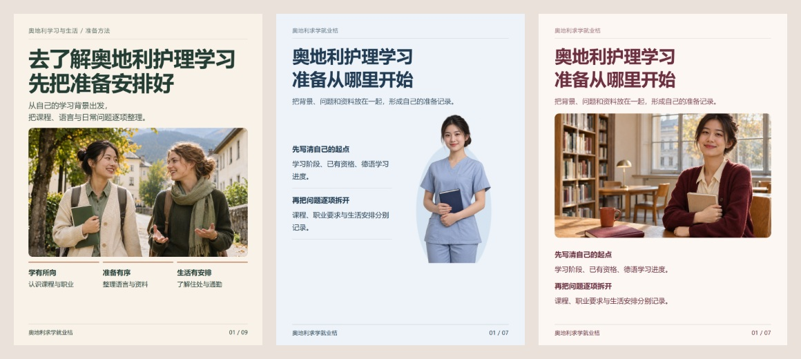

# 三套精选图文模板

这三套模板严格提炼自用户最后确认的成品：T1温暖陪伴叙事、T2雾蓝完整编辑、T3暖白酒红精排。三套来源分别为护理陪伴版、7页完整重设计与护理精排版。



| 输入 | 特征 | 完整预览 |
|---|---|---|
| [t1.json](t1.json) | 护理陪伴版：暖米白深绿、温暖照片、叙事推进、图文解释 | [9页](../../docs/images/template-t1.jpg) |
| [t2.json](t2.json) | 7页完整重设计：雾蓝体系、分区人物封面、结构化说明 | [7页](../../docs/images/template-t2.jpg) |
| [t3.json](t3.json) | 连续段落、宽栏阅读、上下指标、精排步骤 | [7页](../../docs/images/template-t3.jpg) |

三个输入均使用护理准备方法型文案：T1保留原陪伴版9页的叙事结构，T2/T3各7页、使用相同示例内容展示布局差异，共23页。它们是可复用的设计起点，不逐像素复刻原项目，也不包含原项目未核实的金额、补助门槛或服务承诺。后续页数由内容决定。

```sh
node scripts/render-post.cjs --input assets/templates/t3.json --out output/t3-v01
node scripts/audit-package.cjs output/t3-v01
```

修改title、pages、publish及本地配图后再用。运行环境和历史机制见[制作工具](../../references/production-tools.md)。详细选择与精排规则见[模板指南](../../references/selected-templates.md)。

## 素材来源与用途

`media/companion-cover.png`、`companion-class.png`、`companion-room.png`来自护理陪伴版的三个生成场景；`blue-study.png`与`blue-room.png`来自7页完整重设计；`warm-study.png`与`warm-room.png`来自护理精排版。来自本次用户授权整理的既有设计素材，不是实际学生、学校、医院或真实房源证明。每套内部主图互不重复。

成品与发布文案不自动添加AI来源字样；由团队发布时手动使用平台声明功能。素材说明留在本文件与内部制作记录；既有工具/平台强制标识不移除。公开素材也不意味着真实机构、人物或合作背书，不新增第三方素材授权承诺。
